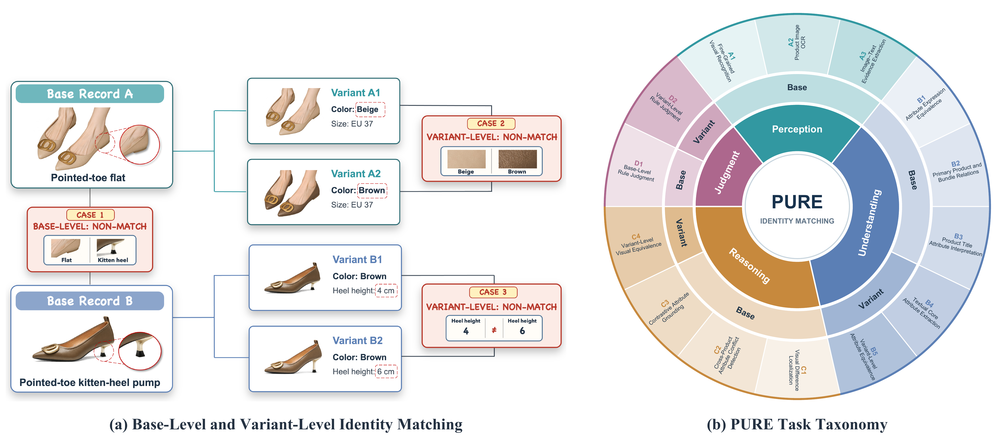
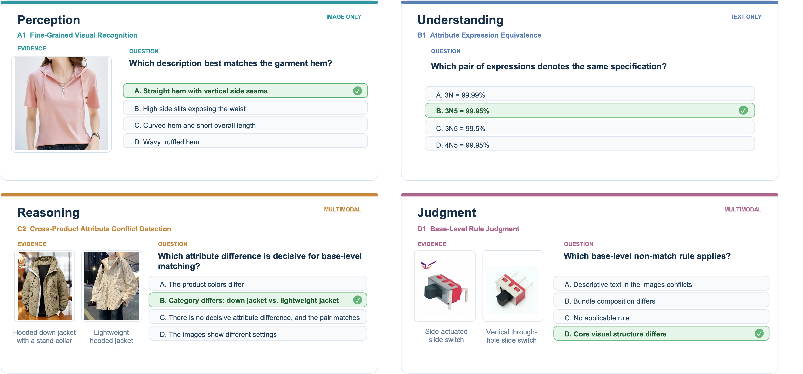

# PURE: A Diagnostic Benchmark for Multi-Granularity Multimodal Identity Matching

[](https://huggingface.co/datasets/alibaba-multimodal-industrial-ai/PURE/blob/main/PURE.pdf)
[](https://huggingface.co/datasets/alibaba-multimodal-industrial-ai/PURE)
[](LICENSE.txt)

PURE is a diagnostic benchmark for multi-granularity multimodal identity matching in e-commerce, covering Perception, Understanding, Reasoning, and Evidence-grounded Judgment. It contains **1,457 Chinese multiple-choice questions across 14 tasks**, with **1,281 unique images**.


## Overview

At the **base level**, two records match when they describe the same underlying design and agree on its core structure, composition, and attributes. Differences in designated attributes, such as color or size, are permitted at this level. At the **variant level**, records must match at the base level and additionally agree on these attributes. A variant-level match therefore implies a base-level match, but not conversely. PURE evaluates the capabilities needed to make these judgments.




## Dataset Summary

| Questions | Unique images | Tasks | Capability dimensions | Matching granularities |
|---:|---:|---:|---:|---:|
| 1,457 | 1,281 | 14 | 4 | 2 |


## Quick Start

### 1. Setup and download the dataset

From the downloaded repository directory:

```bash
python -m pip install -r code/requirements.txt
```

Download the questions and images from PURE on [Hugging Face](https://huggingface.co/datasets/alibaba-multimodal-industrial-ai/PURE). The Hugging Face dataset card provides the full task list and record schema.

```bash
hf download alibaba-multimodal-industrial-ai/PURE \
  --repo-type dataset \
  --local-dir data/PURE
```


### 2. Configure API credentials


```bash
export API_KEY="YOUR_API_KEY"
```


### 3. Run evaluation

```bash
python code/evaluate.py \
  --data-path data/PURE/questions.jsonl \
  --api-base "YOUR_HTTPS_API_BASE" \
  --model "YOUR_MODEL_ID" \
  --output-dir results/my_run \
  --concurrency 5
```

- Add `--smoke` to test four representative questions. To continue with the full benchmark, replace `--smoke` with `--resume`, keeping the other settings and output directory unchanged.


### 4. Score existing outputs (optional)
Scores are computed automatically after evaluation. To recompute scores from saved outputs, run:
```bash
python code/score_pure_results.py \
  --input data/PURE/questions.jsonl \
  --results results/my_run/results.jsonl
```


## Task examples

Examples across the four capability dimensions, shown in English. Correct answers are highlighted in green.




## Citation

```bibtex
@misc{you2026pure,
  title  = {{PURE}: A Diagnostic Benchmark for Multi-Granularity Multimodal Identity Matching},
  author = {Hengyu You and Xintong Wang and Jin Cao and Liang Ding},
  year   = {2026},
  url    = {https://huggingface.co/datasets/alibaba-multimodal-industrial-ai/PURE/blob/main/PURE.pdf}
}
```

## License

This project is licensed under the MIT License.
See [LICENSE.txt](LICENSE.txt) for details.
